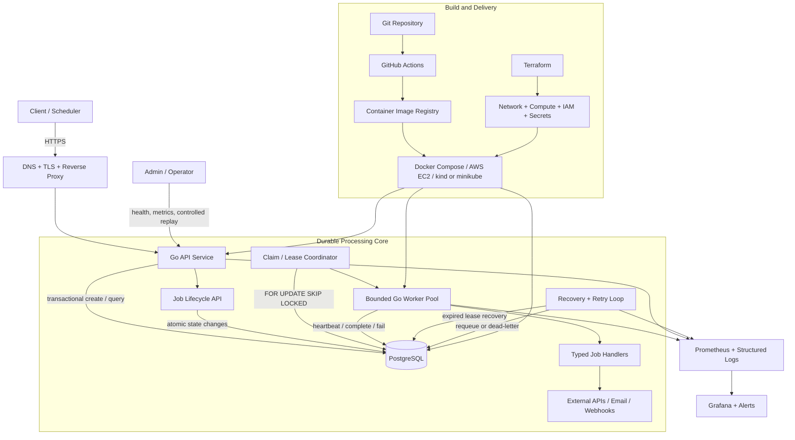

# Durable Job Processor — Mermaid architecture source

> Build delivery (`Git Repository → GitHub Actions → registry → Docker Compose`)
> is implemented in Phase 8. The Terraform, AWS EC2 and kind/minikube branches
> are planned for Phases 9 and 10 and are not present yet.
